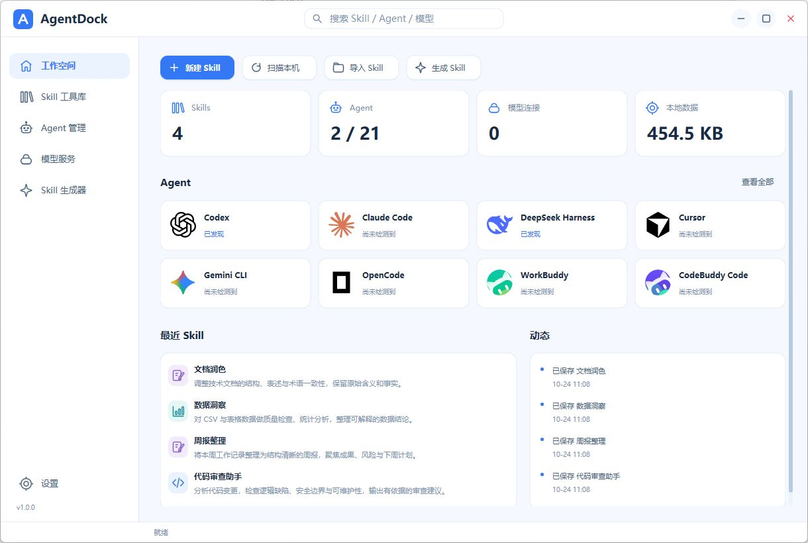

# AgentDock

AgentDock 是面向 Windows 的本地 AI 工具管理器，用于集中管理 Skill、Agent 和大模型服务。软件采用白色与浅蓝色界面，支持原生桌面交互，无需浏览器或额外运行库。

## 主要功能

- **Skill 管理**：分类检索、收藏、导入导出、版本记录，以及用户级和项目级部署。
- **Agent 管理**：集成 Codex、Claude Code、DeepSeek Harness、Cursor、ZCode 等 21 个适配器，支持安装检测、启动、安装卸载及适配范围内的模型配置。
- **模型服务**：提供 GPT、Claude、DeepSeek、Grok、Kimi、Qwen、GLM 等 31 个连接预设，支持多模型列表、默认模型、连接测试与自定义 API。
- **Skill 生成**：通过已配置的模型生成、编辑和完善 Skill，支持草稿保存与质量检查。

## 界面预览



## 构建

运行环境：Windows 10 1703 及以上或 Windows 11，x64。构建需要 Visual Studio 2022 C++ Build Tools（包含 Windows SDK）、CMake 3.24 及以上，以及 Ninja。

在项目根目录执行：

```powershell
powershell -NoProfile -ExecutionPolicy Bypass -File scripts/build-cpp.ps1 -Test
powershell -NoProfile -ExecutionPolicy Bypass -File scripts/package-cpp.ps1
```

构建产物位于 `build/cpp/AgentDock.exe`，发布包位于 `dist/AgentDock-Native-Windows-x64.zip`。可双击 `Start-AgentDock.cmd` 启动已打包或已构建的程序。

使用指南、适配说明、开发与验证资料见 [项目文档](docs/README.md)。
